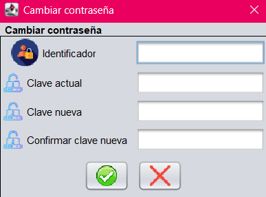
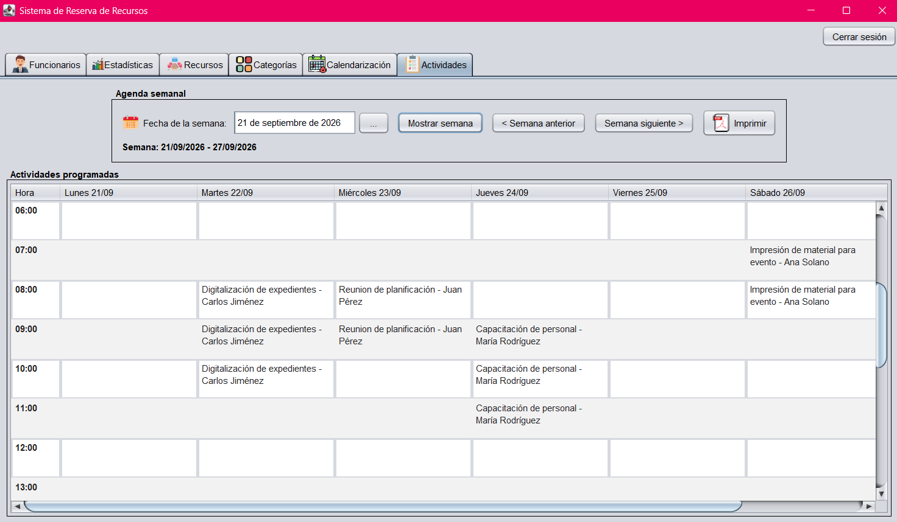

# Sistema de Reserva de Recursos

Aplicación de escritorio en **Java Swing** para gestionar la reserva de recursos institucionales (salas, proyectores, equipo, etc.), con persistencia en **XML vía JAXB**, arquitectura en tres capas y patrón **MVC** por módulo.

Proyecto desarrollado para el curso **EIF206 – Programación 3**.


---

## Características principales

- **Gestión de Funcionarios** con dos roles: `Administrador` y `Funcionario`, controlando qué pestañas ve cada uno.
- **Gestión de Categorías y Recursos** disponibles para reservar.
- **Módulo de Reservas** con detección automática de conflictos de disponibilidad (fecha, horario y categoría solicitada).
- **Calendarización / Agenda** para visualizar reservas por semana.
- **Estadísticas** con gráficos generados con JFreeChart (actividades y uso de recursos por rango de fechas).
- **Generación de reportes en PDF** con iText7.
- **Asistencia con IA** (LangChain4j + OpenAI) para extraer datos de reserva a partir de lenguaje natural.
- **Persistencia XML** mediante JAXB, sin necesidad de base de datos.
- **Pruebas automatizadas** con JUnit Jupiter: tests de unidad (Surefire) y de integración (Failsafe).

---

## 📸 Capturas de pantalla

| Login | Funcionarios |
|---|---|
|  | |

| Cambio de contraseña                                             | Categorías |
|------------------------------------------------------------------|---|
|  |  |

| Recursos | Reservas |
|---|---|
|  |  |

| Calendarización | Agenda                                      |
|---|---------------------------------------------|
|  |  |

| Estadísticas | |
|---|---|
|  | |

---

## Arquitectura

El proyecto sigue una arquitectura de **tres capas**, con un patrón **MVC** replicado en cada módulo funcional:

```
┌─────────────────────────────────────────┐
│              Presentación               │
│  (Views Swing + Controllers por módulo) │
├─────────────────────────────────────────┤
│                 Lógica                  │
│    (Service.java — instancia única      │
│     compartida entre todos los módulos) │
├─────────────────────────────────────────┤
│              Persistencia               │
│  (XmlPersister.java + Data.java — JAXB) │
└─────────────────────────────────────────┘
```

- **`Service`**: una única instancia compartida, expuesta a todos los controladores, que centraliza la lógica de negocio y el acceso a los datos.
- **`Data` / `XmlPersister`**: modelo raíz serializado a `data.xml` mediante JAXB (`@XmlRootElement`, `@XmlAccessorType(FIELD)`).
- **Cada módulo** (Funcionarios, Categorías, Recursos, Reservas, Calendarización, Estadísticas, Agenda) implementa su propio Model–View–Controller, reutilizando el `Service` compartido.

---

## Módulos

| Módulo                            | Descripción |
|-----------------------------------|---|
| **Funcionarios**                  | Alta, edición y consulta de funcionarios. |
| **Login / Autenticación**         | Inicio de sesión con validación de credenciales por rol. |
| **Cambio de contraseña**          | Actualización de clave validando la contraseña actual. |
| **Categorías**                    | Definición de categorías de recursos reservables. |
| **Recursos**                      | Inventario de recursos físicos, asociados a una categoría. |
| **Reservas**                      | Solicitud, asignación automática de recursos disponibles y cancelación de reservas. |
| **Calendarización / Actividades** | Vista semanal de reservas activas. |
| **Estadísticas**                  | Gráficos de uso por categoría y por semana, con filtro de fechas. |

---

## Tecnologías utilizadas

| Categoría | Tecnología |
|---|---|
| Lenguaje | Java |
| UI | Java Swing + [Nimbus Look & Feel](https://docs.oracle.com/javase/tutorial/uiswing/lookandfeel/nimbus.html) |
| Selector de fechas | [LGoodDatePicker](https://github.com/LGoodDatePicker/LGoodDatePicker) 11.2.1 |
| Persistencia | JAXB (`javax.xml.bind` 2.3.1) sobre archivos XML |
| Generación de PDF | [iText7](https://itextpdf.com/) 7.2.3 |
| Gráficos | [JFreeChart](https://www.jfree.org/jfreechart/) 1.5.6 |
| IA / NLP | [LangChain4j](https://docs.langchain4j.dev/) 0.36.2 |
| Build | Maven |
| Testing | JUnit Jupiter · Maven Surefire (unidad) · Maven Failsafe (integración) |

---

## Estructura del proyecto

```
src/
├── main/
│   ├── java/
│   │   ├── data/            # Data.java, XmlPersister.java, adapters JAXB
│   │   ├── logic/            # Service.java, entidades, enums
│   │   └── presentation/     # Views, Controllers, MainView, Application.java
│   └── resources/
│       └── iconos/           # Íconos cargados programáticamente (IconUtil)
└── test/
    └── java/
        ├── logic/             # Tests de unidad (*Test.java)
        └── data/              # Tests de integración (*IT.java)
```

---

## Cómo ejecutar el proyecto

### Requisitos previos

- JDK compatible con la versión configurada en `pom.xml`
- Maven 3.8+

### Pasos

```bash
# Clonar el repositorio
git clone https://github.com/TU_USUARIO/TU_REPOSITORIO.git
cd TU_REPOSITORIO

# Compilar
mvn compile

# Ejecutar la aplicación
mvn exec:java -Dexec.mainClass="presentation.Application"
```

> También puede ejecutarse directamente desde IntelliJ IDEA corriendo la clase `Application.java`.

### Credenciales de prueba (datos semilla)

| Usuario | Clave | Rol |
|---|---|---|
| `admin` | `admin` | Administrador |
| `f001` | `f001` | Funcionario |
| `f002` | `f002` | Funcionario |

---

## Pruebas automatizadas

El proyecto incluye pruebas con **JUnit Jupiter**, separadas según su alcance:

| Tipo | Plugin | Convención | Comando |
|---|---|---|---|
| Unidad | Surefire | `*Test.java` | `mvn test` |
| Integración | Failsafe | `*IT.java` | `mvn verify` |

Las pruebas de unidad validan la lógica de negocio en memoria (por ejemplo, la asignación de recursos disponibles y la detección de conflictos de horario en `Service`), sin tocar el sistema de archivos. Las pruebas de integración validan el ciclo completo de persistencia (`store` → `load`) contra archivos XML reales generados por JAXB.

```bash
# Correr solo pruebas de unidad
mvn test

# Correr pruebas de unidad + integración
mvn verify
```

---

## Equipo

| Integrante                    | Módulo(s) a cargo                            |
|-------------------------------|----------------------------------------------|
| Edith Nicole Bonilla Martínez | Reservas, Funcionarios, Estadísticas         |
| Carlos Jesús Vargas Monge     | Calendarización, Login, Cambio de contraseña |
| José Andrés Calero Rodriguez  | Actividades, Categorías, Recursos            |

---

## 📄 Licencia

Proyecto académico desarrollado para el curso EIF206 – Programación 3. Uso libre con fines educativos.